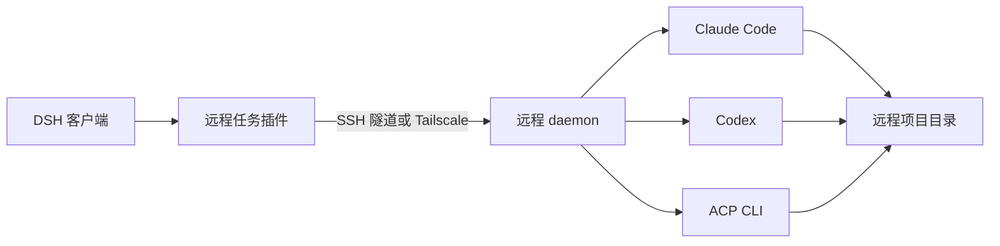

> 实现更新：0.4.0 按用户要求采用 DSH 直接 SSH + 原生 CLI 协议，已移除 Paseo SDK/daemon 依赖，并将原 Claude SSH 完整接入合并。当前供应商为 Claude、Codex、DSH、Antigravity、Grok、CodeBuddy；不再适配 Gemini CLI、Kimi 和 OpenCode。下文保留早期调研背景，当前行为以 [插件说明](../packages/remote-agents/README.zh-CN.md)为准。
>
> 当前 0.2.3 提供 DSH 原生主对话、统一会话列表和分派工具。模型按机器发现，无需登记项目；新会话使用当前 DSH 工作区在远端的同路径。内置 Claude SSH 引擎已由统一 CLI 后端替代。

# 远程 CLI 供应商与任务执行调研

调研日期：2026-10-25。

确认的范围：用户选择远程机器、该机器上的 CLI 供应商和远程项目目录，任务在远程执行。源码、构建环境和 CLI 登录凭据均以远程机器为准。本轮进行了官方文档和源码分析，未安装服务、连接真实远端或调用模型执行任务。

Paseo 源码基准为 [`72e3316f4f5dfe775c77dbf998968c92e2de9019`](https://github.com/getpaseo/paseo/tree/72e3316f4f5dfe775c77dbf998968c92e2de9019)。下文区分已核实的现状与建议设计。

## 结论与建议

该能力可实现。核心是远程任务运行时，包括供应商发现、原生会话、审批和事件恢复。

建议新增独立的 `packages/remote-agents` 插件，把 DSH 交互与执行后端分开。先通过 Paseo daemon + SDK 验证完整链路：远程机器 → 项目 → CLI → 模型 → 发任务 → 审批 → 停止 → 重连。这样可以直接验证 DSH 集成是否满足需求，复用 Paseo 已有的供应商适配。

若后续明确要求远端只安装现有 CLI、不能增加 Paseo 服务，则在同一后端接口下实现自有 runner，逐步接入 Claude、Codex 和 ACP。自有 runner 若也要求客户端断线后任务继续执行，需要远端进程托管与事件存储；只依赖前台 SSH 管道不足以承诺这一行为。

以上是基于源码的工程判断；尚未通过实际 DSH 插件验证 Paseo SDK 桥接。

## Paseo 已经实现了什么

Paseo 在执行机器上运行 Node.js daemon，管理本机安装的 agent CLI。桌面、移动、Web 和命令行客户端连接 daemon，接收统一的任务和时间线事件。远程机器也运行自己的 daemon，任务的 `cwd` 是那台机器上的路径。详见[架构](https://github.com/getpaseo/paseo/blob/72e3316f4f5dfe775c77dbf998968c92e2de9019/docs/architecture.md)。

- **连接**：Paseo 支持 SSH 隧道、直接连接和可选的加密 relay。SSH 模式连接已运行的远端 daemon，不负责安装、启动或配置服务。这个前置条件必须体现在主机状态里。见[连接文档](https://github.com/getpaseo/paseo/blob/72e3316f4f5dfe775c77dbf998968c92e2de9019/public-docs/connectivity.md)。
- **发现**：SDK 提供供应商快照、模型、模式、能力和诊断接口。供应商快照有 `loading`、`ready`、`unavailable`、`error` 状态，目录需要传远端 `cwd`；不同机器的安装与配置可以不同。见[供应商 SDK](https://github.com/getpaseo/paseo/blob/72e3316f4f5dfe775c77dbf998968c92e2de9019/public-docs/sdk/providers.md)。
- **适配**：原生适配器实现 `AgentClient` / `AgentSession`，通用 ACP 适配器复用协议处理。供应商负责创建、续接、输入、中断、审批和原生会话句柄，daemon 管理上层任务。见[供应商接入](https://github.com/getpaseo/paseo/blob/72e3316f4f5dfe775c77dbf998968c92e2de9019/docs/providers.md)与[接口定义](https://github.com/getpaseo/paseo/blob/72e3316f4f5dfe775c77dbf998968c92e2de9019/packages/server/src/server/agent/agent-sdk-types.ts)。
- **配置**：自定义供应商支持启动命令数组、环境变量、模型覆盖和供应商别名。模型服务商与 CLI 供应商是两个维度，例如同一个 CLI 可以指向不同模型端点。见[自定义供应商](https://github.com/getpaseo/paseo/blob/72e3316f4f5dfe775c77dbf998968c92e2de9019/public-docs/custom-providers.md)。

## 各 CLI 的接入方式

| CLI | 已核实接口 | 对本项目的含义 |
| --- | --- | --- |
| Claude Code | `claude -p` 支持结构化输出、流式事件和会话续接；Paseo 使用 Claude Agent SDK | 现有插件已经完成大量 Claude 专用接入，可复用经验和经过验证的部件 |
| Codex | `codex app-server` 提供双向 JSONL 通信，包含线程、轮次、模型列表、审批和中断 | 使用原生 app-server；按安装版本生成/校验 schema，默认以 stdio 接入远程运行时 |
| Kimi Code | 当前官方 CLI 文档提供 `kimi acp`，通过 stdin/stdout 接受 JSON-RPC | 可以进入 ACP 适配层，但应探测实际安装版本与能力 |
| Gemini CLI | 官方提供 ACP 集成 | 可作为通用 ACP 适配器的另一个验证对象 |
| OpenCode | `opencode serve` 提供 HTTP API、会话和 SSE 事件流 | 可通过专用适配器接入；需要同时处理 HTTP 请求和事件流 |

来源：[Claude 官方文档](https://code.claude.com/docs/en/headless)、[OpenAI 官方 App Server 文档](https://learn.chatgpt.com/docs/app-server)、[Kimi 官方 ACP 文档](https://www.kimi.com/code/docs/en/kimi-code-cli/reference/kimi-acp.html)、[Gemini 官方 IDE 集成](https://geminicli.com/docs/ide-integration/)、[OpenCode 官方 Server 文档](https://opencode.ai/docs/server/)。

注意两个已经核实的接口边界：

1. OpenAI 官方文档将 app-server 的 WebSocket 传输标为 experimental / unsupported。初始设计可让远端 daemon 使用 stdio 启动 Codex，通过自己的主机连接层提供远程访问。
2. ACP 官方当前页面区分 **v1 Latest** 与 **v2 Draft**。会话恢复、模型/模式和客户端文件/终端能力需要协商，不能把一种 CLI 的行为套到所有 ACP agent。见[ACP v1 概览](https://agentclientprotocol.com/protocol/v1/overview)。

## 当前仓库的基础与耦合

| 本地代码 | 可复用的能力 | 扩展时需要拆开的部分 |
| --- | --- | --- |
| `packages/claude-ssh/src/compatibility/workspace.ts` | 读取远程镜像元数据；核对主机、用户、端口、远程目录；保存会话绑定 | 工作区身份验证目前直接调用 `claude --version` 和 `claude auth status` |
| `packages/claude-ssh/src/compatibility/transport.ts` | 固定 SSH 端点，保留 SSH 配置中的别名与连接方式 | `PinnedTarget.command` 对应现有 Claude 路径配置 |
| `packages/claude-ssh/src/compatibility/catalog.ts` | 到实际执行 CLI 查询工作区模型；限制超时与输出大小 | 查询协议和规范化结果固定为 Claude，模型 provider 固定为 `claude-code` |
| `packages/claude-ssh/src/process.ts` | 本地、SSH、DSH subprocess 的进程接口；keeper 等进程管理机制 | `ClaudeProcess` 和控制事件围绕 Claude 协议设计 |
| `packages/claude-ssh/src/adapter/class.ts` | DSH 流式消息、审批、问题、原生会话和进程管理 | 继承 `LlmAdapter`，包含大量 Claude 专用生命周期与面板行为 |
| `packages/claude-ssh/src/client/workspace-models.tsx` 等 | 按会话工作区查询模型、显示资格与选择模型 | 当前资格检查只返回 Claude provider |

当前插件已经具备远程执行基础。工作区身份验证与供应商可用性应成为两个独立步骤：身份验证成功后，即使 Claude 不存在，也应该允许发现该机器上的 Codex 或其他 CLI。

现有远程 Claude 回合明确不注入 DSH 本机 loopback MCP bridge，相关判断在 `adapter/class.ts` 的 `prepare()`。因此远端 CLI 的原生工具可以执行远程任务，但“还能调用 DSH 主机上的全部工具”是单独的接入范围，需要可达的桥接通道。

建议先保持现有 Claude SSH 的行为，在新插件中验证统一任务接口。需要共享的传输与身份代码再提取，减少既有 Claude 会话迁移的影响。

## 两条实现路线

| 维度 | Paseo daemon + DSH 桥接 | 自有远程 runner + CLI 适配器 |
| --- | --- | --- |
| 远端部署 | 安装并启动 Paseo daemon，另行安装和登录各 CLI | 部署自己的 runner；受限模式可先用 SSH 管道 |
| 供应商维护 | 主要复用 Paseo 已有适配 | 持续维护各 CLI 的协议和版本差异 |
| DSH 集成 | 主机/任务 UI、会话映射、事件转换、审批桥接 | 除 DSH 集成外，还要实现远程任务运行时 |
| 断线恢复 | 使用 daemon 任务记录与时间线；客户端负责补读 | 实现托管进程、任务状态、历史和重连 |
| 控制程度 | 受 Paseo 公共 SDK 与版本兼容性约束 | 可完全定义接口、状态与发布方式 |
| 本轮判断 | 适合先验证产品链路 | 适合确定需要独立后端后逐步建设 |

Paseo SDK 已有创建/续发任务、读取状态、时间线、供应商发现及 `respondToPermission()`。但仍需实测两处桥接：

- 当前公共 agent handle 文档没有列出停止方法；源码的低层 `DaemonClient.cancelAgent()` 支持取消。集成时应把这类调用封装在单一后端中，并锁定兼容版本。
- 公共 `createPaseoClient()` 接受 WebSocket endpoint。Node 子路径另有 SSH transport / tunnel helpers。不能直接假定把 `ssh://...` 传给公共客户端的 `url` 就可连接。

对应源码：[公共客户端](https://github.com/getpaseo/paseo/blob/72e3316f4f5dfe775c77dbf998968c92e2de9019/packages/client/src/index.ts)、[低层客户端](https://github.com/getpaseo/paseo/blob/72e3316f4f5dfe775c77dbf998968c92e2de9019/packages/client/src/daemon-client.ts)、[Node 连接层](https://github.com/getpaseo/paseo/blob/72e3316f4f5dfe775c77dbf998968c92e2de9019/packages/client/src/node/index.ts)、[SDK 参考](https://github.com/getpaseo/paseo/blob/72e3316f4f5dfe775c77dbf998968c92e2de9019/public-docs/sdk/reference.md)。

Paseo 主体采用 Apache-2.0，第三方部分保留各自许可。若后续复制实现，应同时检查所复制文件和依赖的声明。见[源码 LICENSE](https://github.com/getpaseo/paseo/blob/72e3316f4f5dfe775c77dbf998968c92e2de9019/LICENSE)。

## 建议的数据与接口边界

以下是本项目的建议设计，并非现有接口。

- `Host`：稳定 ID、连接配置、执行身份、连通状态。
- `Workspace`：所属 Host、远程绝对目录、身份校验结果。
- `ProviderInstallation`：所属 Host、CLI 类型、解析后的可执行路径、版本、认证状态、能力。
- `ProviderProfile`：安装实例及配置别名；模型端点、环境配置由后端保管。
- `TaskSession`：DSH 会话 ID、Host ID、Workspace ID、Provider ID、原生会话句柄。
- `Turn`：客户端提交 ID、远端轮次 ID、运行状态、当前审批和结果。

后端提供 `listProviders(workspace)`、`listModels(provider, workspace)`、`createSession()`、`sendPrompt()`、`respondToPermission()`、`interrupt()`、`readTimeline(cursor)` 和 `subscribe()`。执行请求携带完整目标身份，后台重新核对绑定。

把安装、认证和协议状态分开记录。找到二进制、`--version` 成功或返回模型列表，都不能单独证明任务一定能成功；认证未知时显示未知，不通过隐藏的模型推理来探测。

CLI 管理自己的原生任务循环，DSH 负责交互和显示。原生工具执行结果转换成 DSH 可展示的事件，避免 DSH 再执行一次相同工具。若使用 `LlmAdapter` 接入已有聊天，需要实测该执行语义；任务面板可以先独立验证。

## 必须纳入最小版本的恢复语义

1. **任务身份**：固定主机、目录、供应商和原生会话 ID。切换供应商创建新的原生会话，若需交接则显式传递摘要。
2. **提交确认**：使用客户端提交 ID，并确认后端去重能力。提交响应丢失时先查任务状态，避免重复执行。
3. **审批回传**：保留供应商 request ID 和选项 ID；区分允许一次、拒绝、取消及等待回答。
4. **停止**：调用供应商原生中断，处理运行中的命令和未消费的输入。关闭 SSH 连接与停止远程任务是不同操作。
5. **客户端断线**：远端任务可继续运行，重连后重新订阅并补读记录。
6. **daemon 重启**：恢复持久会话历史与恢复原先仍在运行的进程是不同保证，需要逐供应商验证。

Paseo SDK 的实时订阅在重连后会恢复，但不会自动回放漏掉的消息。需要使用时间线 cursor 补读，按 epoch / sequence 合并去重。`waitForFinish()` 超时也不会取消任务。来源：[SDK 事件](https://github.com/getpaseo/paseo/blob/72e3316f4f5dfe775c77dbf998968c92e2de9019/public-docs/sdk/events.md)、[SDK Agent 生命周期](https://github.com/getpaseo/paseo/blob/72e3316f4f5dfe775c77dbf998968c92e2de9019/public-docs/sdk/agents.md)。

## 最小版本的验证顺序

1. 在单台远端验证 Claude Code 和 Codex：机器/项目选择、供应商发现、动态模型列表、流式任务结果。
2. 完成后续消息、审批、用户问题、中断，以及浏览器刷新后的状态恢复。
3. 验证网络断开、提交确认丢失、daemon 重启和绑定改变；给每种情况明确的 UI 状态。
4. 加入一个 ACP agent，再使用第二个 ACP agent 验证通用层；增加版本与能力诊断。
5. 在远端 worktree 中支持并行任务，再扩展终端、diff、更多 CLI 和安装引导。

首个闭环的验收标准：用户从 DSH 选中远端项目和 CLI，完成一次需要审批的代码修改任务；客户端断线后仍可找回任务、补齐输出、发送后续指令，并确认停止确实终止远端执行。
